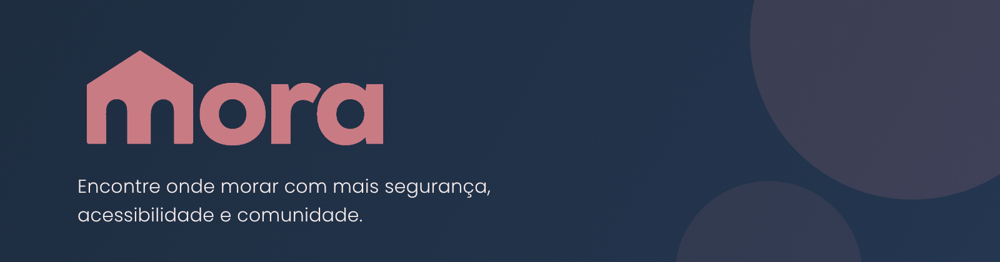
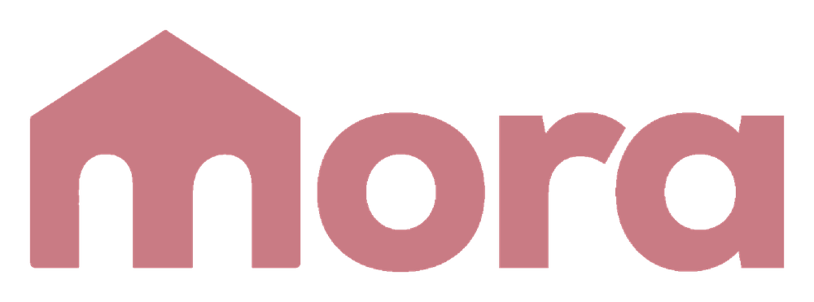
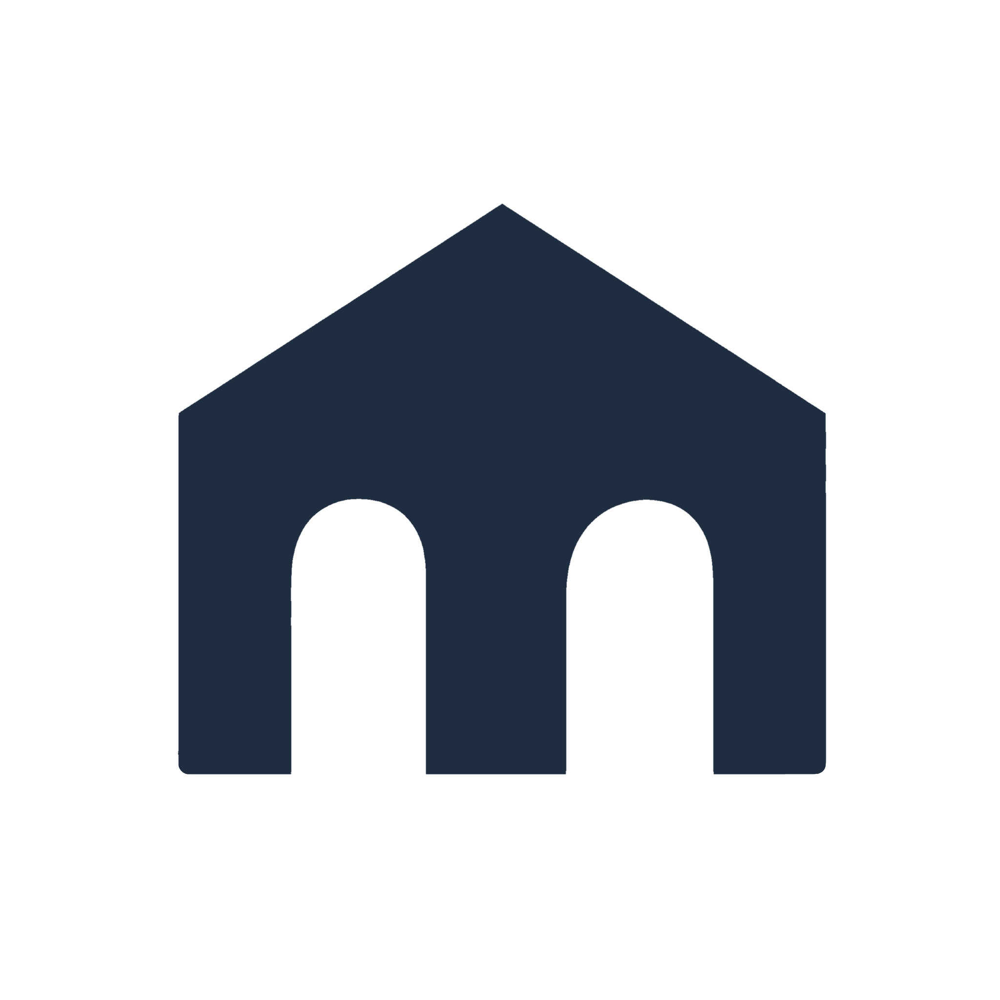
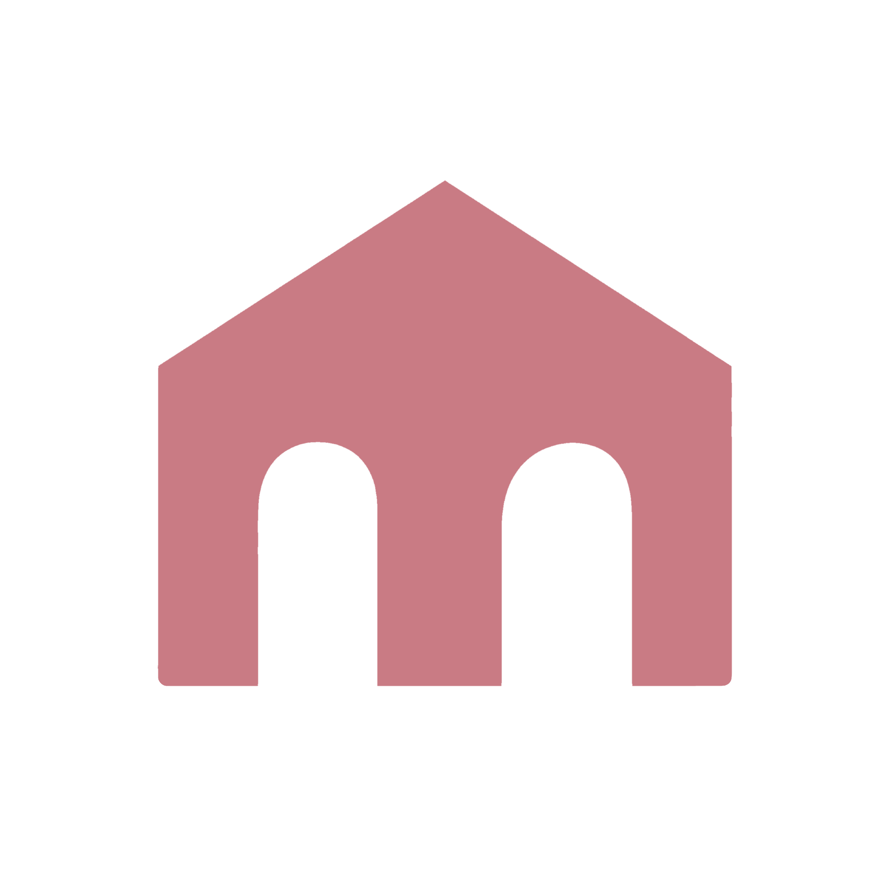

<p align="center">
  
</p>

<p align="center">
  
  
  
  
</p>

---

## 🏡 Sobre o Mora

O **Mora** é uma plataforma de aluguel de imóveis por diária ou por mês, com espaço
também para repúblicas universitárias. A ideia é juntar busca e filtros pensados
para quem mais precisa de **segurança** e **acessibilidade** na hora de escolher
onde morar, e construir uma **comunidade** em volta disso.

É um projeto pessoal, em desenvolvimento ativo, que eu pretendo fazer crescer
com o tempo. Hoje ele está na fase de **esqueleto**: telas, navegação e busca
funcionando no front-end, preparando o terreno para o resto.

## 🌱 A história do projeto

Este repositório guarda a evolução de uma ideia. Cada fase ensinou algo
e está registrada no histórico de commits.

| Fase | O que era | O que eu aprendi |
|---|---|---|
| **1. Airbnb Garage** | Protótipo em HTML e CSS de uma plataforma de aluguel de garagens. Está na pasta `legacy`. | Estruturar páginas, CSS e responsividade |
| **2. Recomeço em React** | Refiz tudo do zero, entendendo cada peça: componentes, props, `useState`, listas e busca | A lógica de uma aplicação em React |
| **3. Garagely** | Primeira identidade própria, ainda focada em garagens e armazenamento | Design com variáveis de cor, modo claro e escuro |
| **4. Mora** | A ideia cresceu: imóveis, repúblicas e comunidade. Nome e identidade visual novos | Pensar em produto, não só em código |

> Recomeçar do zero e entender de verdade o que cada linha faz foi a melhor
> decisão do projeto. 💜

## 🎨 Identidade visual

<p align="center">
  
  &nbsp;&nbsp;&nbsp;&nbsp;
  
</p>

<p align="center">
  
  &nbsp;&nbsp;&nbsp;&nbsp;
  
</p>

### Paleta

<p align="center">
  
  
  
</p>

O ícone é uma casa cujas duas aberturas em arco formam a letra **m**, lembrando
portas, janelas e um lar.

### Espaço para a marca

> 📌 *Área reservada para o material de marca. Imagens ficam em `docs/brand/`.*

| Aplicações da marca | Telas do produto |
|---|---|
| *(mockups e aplicações em breve)* | *(prints do site em breve)* |

## ✨ O que já funciona

- [x] Layout responsivo com modo claro e escuro automático
- [x] Header com logo, menu de navegação e botões de entrar e cadastrar
- [x] Grade de cards de imóveis
- [x] Busca por nome e cidade, com aviso quando nada é encontrado

## 🚧 Em planejamento

- [ ] Filtros de modalidade, preço e pet friendly
- [ ] Página de detalhes do imóvel
- [ ] Cadastro e login de usuário
- [ ] Cadastro de imóvel
- [ ] API com Node.js e banco de dados PostgreSQL

## 🛠️ Tecnologias

| Camada | Ferramentas |
|---|---|
| Front-end | React, Vite, CSS com variáveis |
| Planejado | Node.js, Express, PostgreSQL, Prisma |

## 🚀 Como rodar

```bash
git clone https://github.com/adrianadamore/Mora.git
cd Mora/client
npm install
npm run dev
```

Depois é só abrir o endereço que aparecer no terminal (normalmente `http://localhost:5173`).

## 📁 Estrutura

```
Mora/
├── client/    # front-end em React
├── docs/      # banner e identidade visual
└── legacy/    # primeira versão (Airbnb Garage), em HTML e CSS
```

## 📚 O que estou praticando

Componentes e props, `useState`, listas com `map`, filtros com `filter`,
renderização condicional com operador ternário, organização de pastas
e documentação de projeto.

## 👩‍💻 Quem faz

**Adriana Valentina D'Amore**
Estudante de Ciência e Tecnologia na UFABC e do técnico em Desenvolvimento de Sistemas.

[](https://www.linkedin.com/in/adriana-valentina-damore)
[](https://github.com/adrianadamore)
[](mailto:adrianadamore3009@gmail.com)

---

## ⚖️ Direitos reservados

© 2026 Adriana Valentina D'Amore. **Todos os direitos reservados.**

O nome **Mora**, a identidade visual (logo, ícone, paleta e demais elementos de marca)
e o código deste repositório são de autoria de Adriana Valentina D'Amore.
O repositório é público apenas para consulta e avaliação como portfólio.
Não é permitido copiar, modificar, distribuir ou utilizar o código, a marca
ou qualquer parte do projeto, total ou parcialmente, sem autorização prévia e por escrito.

Projeto em desenvolvimento, sem fins comerciais até o momento.