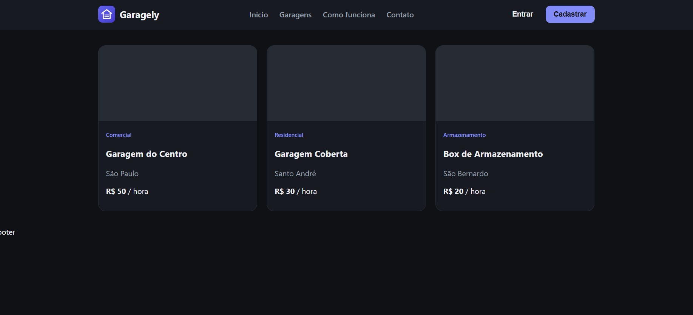
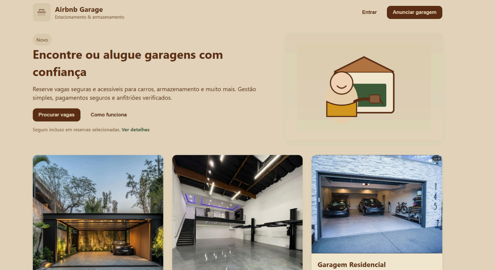

<p align="center">
  <picture>
    <source media="(prefers-color-scheme: dark)" srcset="docs/garagely-logo-escuro.png">
    
  </picture>
</p>

<p align="center">
  <em>Um cantinho seguro para o seu carro e para as suas coisas ✨</em>
</p>

<p align="center">
  
  
  
  
</p>

---

## 💜 Sobre o projeto

O **Garagely** é uma plataforma para alugar garagens e espaços de armazenamento.
Ele começou como um protótipo em HTML e CSS (que ainda mora na pasta `legacy`) durante meu curso técnico
e agora está sendo reconstruído do zero, como projeto full stack, para eu
praticar front-end, API e banco de dados.

> Projeto de estudo e portfólio, feito com carinho e muita depuração. 🌷

## 🖼️ Preview

Essa é a tela inicial do Garagely em desenvolvimento.

Essa era a tela antiga do "Airbnb Garage" feita com HTML e CSS.



## 🌸 O que já funciona

- [x] Visual limpo, responsivo, com modo claro e escuro automático
- [x] Header com logo, menu de navegação e botões de entrar e cadastrar
- [x] Grade de cards de garagens
- [x] Busca por nome e cidade, com aviso quando nada é encontrado

## 🌱 O que vem por aí

- [ ] API com Node.js e Express
- [ ] Banco de dados PostgreSQL com Prisma
- [ ] Login e cadastro com JWT
- [ ] Cadastro de garagens
- [ ] Deploy

## 🛠️ Tecnologias

| Camada | Ferramentas |
|---|---|
| Front-end | React, Vite, CSS com variáveis |
| Planejado | Node.js, Express, PostgreSQL (Neon), Prisma |

## 🚀 Como rodar

```bash
git clone https://github.com/adrianadamore/Garagely.git
cd Garagely/client
npm install
npm run dev
```

Depois é só abrir o endereço que aparecer no terminal (normalmente
http://localhost:5173).

## 📁 Estrutura

```
Garagely/
├── client/    # front-end em React
├── docs/      # imagens do README
└── legacy/    # a primeira versão, em HTML e CSS
```

## 📚 O que estou aprendendo

Componentes e props, `useState`, listas com `map`, filtros com `filter`,
renderização condicional com operador ternário e organização de projeto.

## 👩‍💻 Quem fez

**Adriana Valentina D'Amore**
Estudante de Ciência e Tecnologia na UFABC e do Técnico em Desenvolvimento de Sistemas.

[](https://www.linkedin.com/in/adriana-valentina-damore)
[](https://github.com/adrianadamore)
[](mailto:adrianadamore3009@gmail.com)